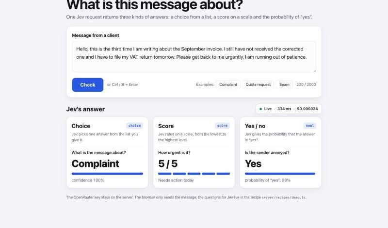

# Jev Starter po polsku

Gotowy szkielet małej aplikacji webowej, która podejmuje decyzje modelem **Jev** (TypeSafe) przez **OpenRouter**.
Jev nie pisze tekstów, tylko odpowiada na pytania o tekst: wybiera opcję z listy, ocenia na skali albo podaje szansę na „tak”. Robi to w ok. pół sekundy i za ok. 0,00002 USD za zapytanie.

Starter powstał do odcinka na kanale Detechtive: https://www.youtube.com/@detechtiveinfo
Pełny opis (po angielsku) jest w [README.md](README.md).



## Start w 3 krokach

**1. Klucz.** Utwórz klucz na https://openrouter.ai/settings/keys i od razu ustaw na nim limit kredytów (np. 5 USD). Potem skopiuj plik z ustawieniami:

```bash
cp .env.example .env
```

Otwórz `.env` i wklej klucz po `OPENROUTER_API_KEY=`. Ten plik nie trafia do gita.

**2. Uruchomienie.** Potrzebujesz Node.js 22.12 lub nowszego.

```bash
npm install
npm run dev
```

Otwórz http://localhost:5173 i sprawdź demo.

**3. Twoja aplikacja.** Otwórz folder w Claude Code albo Codex i opisz po polsku w 4–5 zdaniach, co ma powstać: kto będzie z niej korzystał, co do niej wkleja i jakie decyzje ma podjąć Jev. Na przykład:

> Zbuduj na tym starterze aplikację do sortowania zgłoszeń z formularza mojej szkoły językowej.
> Wklejam treść zgłoszenia, a Jev ocenia, jakiego kursu dotyczy, czy chodzi o dziecko czy dorosłego i jak bardzo osoba jest zdecydowana na zapis.
> Wynik pokaż w trzech kartach, a pod nimi pasujący szablon odpowiedzi z krótkiej listy, którą Ci podam. Interfejs po polsku, z dużymi literami.

Agent odpowie po polsku i zrobi interfejs po polsku. Wszystko, czego potrzebuje, znajdzie w [AGENTS.md](AGENTS.md).

## Wdrożenie jednym poleceniem

W tym samym oknie agenta napisz:

> Wdróż tę aplikację na mój VPS w Hostingerze.

Agent znajdzie serwer (przez konektor Hostinger albo zapyta o IP), sprawdzi, co już na nim działa, i niczego z tego nie wyłączy. Na koniec poda adres z HTTPS. Jeśli masz domenę lub subdomenę, podaj ją. Bez domeny dostaniesz darmowy adres w sslip.io.

Klucz zostaje na serwerze, a aplikacja ma dzienny limit wydatków i limit zapytań na adres IP.
